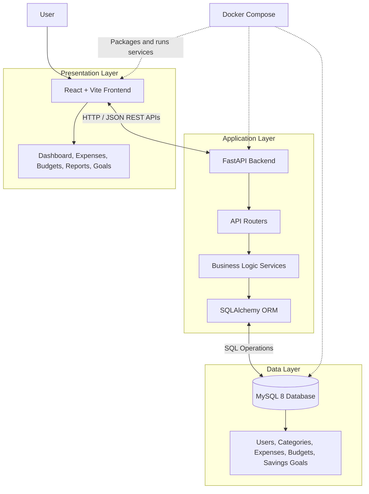
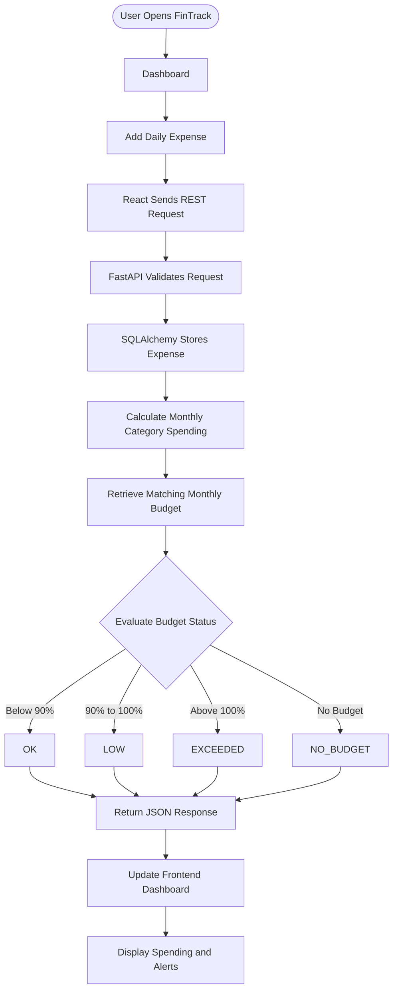
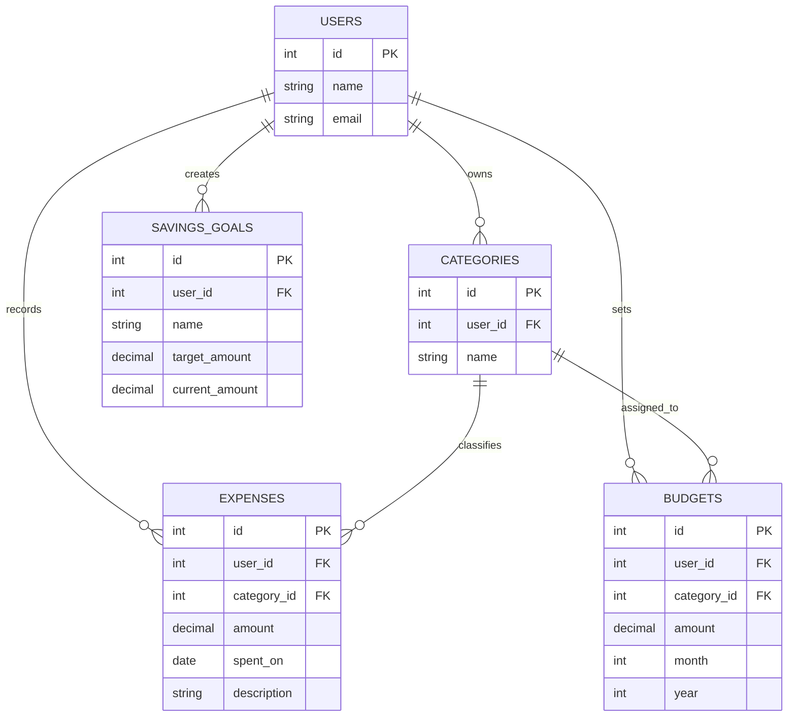

# FinTrack – Smart Expense & Savings Management System

<p align="center">
  <strong>A smarter way to track expenses, manage budgets, and achieve financial goals.</strong>
</p>

<p align="center">
  
  
  
  
  
</p>

---

## Overview

**FinTrack** is a full-stack personal finance management application that helps users understand where their money goes, control monthly spending, and track their savings goals.

Instead of manually maintaining expense records and calculating budgets, FinTrack provides a centralized dashboard that organizes financial transactions, monitors category-wise spending, and automatically identifies budget limits.

The application follows a three-tier architecture with a React frontend, Python FastAPI backend, and MySQL relational database.

Its key design principle is to keep financial calculations and budget-monitoring logic in the backend while providing a simple and interactive experience through the frontend.

## The Problem

Managing personal finances becomes difficult when expenses are recorded in different places and monthly budgets are tracked manually.

Common challenges include:

- Losing track of daily spending.
- Difficulty identifying high-spending categories.
- Exceeding monthly budgets without noticing.
- Comparing actual expenses against planned budgets.
- Maintaining consistent savings goals.

## The Solution

FinTrack addresses these challenges through an integrated expense and budget management system.

It records daily transactions, organizes them into categories, calculates monthly spending, compares expenses against allocated budgets, and displays alerts when spending approaches or exceeds a budget.

Users can also create savings goals and monitor their progress through the application.

---

## Key Features

### 1. Expense Management
- Record daily expenses with amount, category, date, and description.
- Create, view, update, and delete transactions.
- Filter expenses by month and category.
- Maintain transaction records in MySQL.

### 2. Category-Based Budget Management
- Set individual monthly budgets for expense categories.
- Maintain separate budgets for different months and years.
- Update existing category budgets.
- View allocated, spent, and remaining amounts.

### 3. Intelligent Budget Monitoring
FinTrack evaluates budget utilization in the backend whenever relevant expense information changes.

| Budget condition | Status | UI indication |
|---|---|---|
| Less than 90% utilized | OK | Green |
| 90% to 100% utilized | LOW | Amber |
| More than 100% utilized | EXCEEDED | Red |
| No budget configured | NO_BUDGET | Informational |

**Calculation logic:**

Remaining Amount = Allocated Budget − Total Spending

Budget Utilization (%) = (Total Spending / Allocated Budget) × 100

The backend determines the alert status and returns it as part of the API response. The frontend is responsible only for displaying the result.

### 4. Financial Reports and Analytics
- View total spending for a selected month.
- Compare category-wise actual spending against allocated budgets.
- Monitor remaining budget amounts.
- Visualize budget utilization through interactive charts using Recharts.

### 5. Savings Goal Tracking
- Create savings goals with target amounts.
- Record contributions towards goals.
- Track current savings and remaining amounts.
- Visualize progress using progress indicators.

### 6. Centralized Dashboard
- Monthly financial overview.
- Expense summaries.
- Category-wise budget information.
- Budget alerts.
- Recent transactions.
- Savings goal progress.

---

## System Architecture

FinTrack follows a **three-tier architecture** to maintain separation of responsibilities, modularity, and maintainability.



### Architecture Responsibilities

| Layer | Technology | Responsibility |
|---|---|---|
| Presentation | React + Vite | User interaction and data visualization |
| Application | FastAPI | REST APIs, validation, and business logic |
| Service | Python | Expense calculations, budget evaluation, and reports |
| Persistence | SQLAlchemy ORM | Database queries and object-relational mapping |
| Data | MySQL 8 | Persistent relational data storage |
| Deployment | Docker Compose | Containerized application execution |

### Why This Architecture?

- **Separation of concerns:** Each layer has a clearly defined responsibility.
- **Maintainability:** Backend business logic is separated from HTTP routes.
- **Data consistency:** Financial calculations are handled centrally in the backend.
- **Modularity:** New features can be added without restructuring the entire application.
- **Portability:** Docker Compose provides a consistent execution environment.

---

## Application Workflow

The following workflow explains how an expense moves through the application.



### Example Budget Evaluation

Consider a monthly Food budget of ₹5,000.

| Total spending | Remaining | Result |
|---:|---:|---|
| ₹2,000 | ₹3,000 | OK |
| ₹4,000 | ₹1,000 | OK |
| ₹4,500 | ₹500 | LOW |
| ₹5,000 | ₹0 | LOW |
| ₹5,500 | -₹500 | EXCEEDED |

This evaluation is performed by the backend using monthly category-wise expense aggregation.

---

## Database Design

FinTrack uses MySQL 8 with SQLAlchemy 2.x ORM.

The relational database contains the following entities:

| Table | Description |
|---|---|
| users | Stores user records |
| categories | Stores expense categories |
| expenses | Stores individual expense transactions |
| budgets | Stores category-wise monthly budgets |
| savings_goals | Stores savings targets and current progress |

### Entity Relationships



### Database Design Considerations

- Primary and foreign keys maintain relational integrity.
- Financial values use decimal-based database types.
- Monthly budgets are identified using category, month, and year.
- A uniqueness constraint prevents duplicate budgets for the same category and month.
- SQLAlchemy ORM manages database interactions.

**User model note:** The current implementation uses a single default user. Authentication and multi-user session management are not part of the current application.

---

## REST API Documentation

The frontend communicates with FastAPI through JSON-based REST endpoints.

Interactive API documentation is available through Swagger UI.

**Swagger URL:** `http://localhost:8000/docs`

### API Endpoint Reference

| Module | Method | Endpoint | Purpose |
|---|---|---|---|
| Health | GET | `/health` | Check backend availability |
| Categories | GET | `/categories` | Retrieve categories |
| Categories | POST | `/categories` | Create a category |
| Expenses | GET | `/expenses` | Retrieve expenses |
| Expenses | POST | `/expenses` | Add an expense |
| Expenses | PUT | `/expenses/{id}` | Update an expense |
| Expenses | DELETE | `/expenses/{id}` | Delete an expense |
| Budgets | GET | `/budgets` | Retrieve monthly budgets |
| Budgets | PUT | `/budgets` | Create or update a budget |
| Alerts | GET | `/alerts` | Retrieve budget statuses |
| Reports | GET | `/reports/monthly-total` | Retrieve monthly spending |
| Reports | GET | `/reports/budget-vs-spend` | Compare budget and spending |
| Goals | GET | `/goals` | Retrieve savings goals |
| Goals | POST | `/goals` | Create a savings goal |
| Goals | PATCH | `/goals/{id}/contribute` | Add a savings contribution |

### Example API Request

Create an expense:

```http
POST /expenses
Content-Type: application/json
```

```json
{
  "category_id": 1,
  "amount": "250.00",
  "spent_on": "2026-11-27",
  "description": "Lunch"
}
```

Create or update a monthly budget:

```http
PUT /budgets
Content-Type: application/json
```

```json
{
  "category_id": 1,
  "month": 11,
  "year": 2026,
  "amount": "5000.00"
}
```

Retrieve budget alerts:

```http
GET /alerts?month=2026-11
```

All API requests are validated by the backend before database operations are performed.

---

## Project Structure

```text
FinTrack/
│
├── backend/
│   ├── app/
│   │   ├── main.py
│   │   ├── database.py
│   │   ├── config.py
│   │   │
│   │   ├── models/
│   │   ├── schemas/
│   │   ├── routers/
│   │   └── services/
│   │
│   ├── tests/
│   ├── seed.py
│   ├── requirements.txt
│   └── Dockerfile
│
├── frontend/
│   ├── src/
│   │   ├── components/
│   │   ├── pages/
│   │   ├── api.js
│   │   ├── App.jsx
│   │   └── styles.css
│   │
│   ├── package.json
│   └── Dockerfile
│
├── docker-compose.yml
├── .env.example
├── .gitignore
└── README.md
```

---

## Technology Stack

| Technology | Usage |
|---|---|
| React.js | Component-based frontend |
| Vite | Frontend development and build tooling |
| JavaScript | Frontend application logic |
| CSS3 | Interface styling |
| Recharts | Financial charts and visualization |
| Python | Backend programming |
| FastAPI | REST API framework |
| Pydantic | Input and output validation |
| SQLAlchemy 2.x | ORM and database operations |
| MySQL 8 | Relational database |
| Uvicorn | ASGI application server |
| Docker | Application containerization |
| Docker Compose | Multi-container orchestration |
| Pytest | Backend testing |

---

## Installation and Execution

### Prerequisites

- Docker
- Docker Compose

### Step 1: Clone the Repository

```bash
git clone https://github.com/Shubhashree-Badiger/FinTrack.git
cd FinTrack
```

### Step 2: Configure Environment Variables

Copy the example configuration:

```bash
cp .env.example .env
```

For Windows PowerShell:

```powershell
Copy-Item .env.example .env
```

Review the environment variables and configure them as required.

### Step 3: Build and Run

```bash
docker compose up --build
```

Docker Compose starts the frontend, backend, and MySQL services.

### Step 4: Access the Application

| Service | URL |
|---|---|
| Frontend | http://localhost:5173 |
| Backend | http://localhost:8000 |
| API Documentation | http://localhost:8000/docs |
| Health Check | http://localhost:8000/health |

### Step 5: Stop the Application

```bash
docker compose down
```

To remove containers and the database volume:

```bash
docker compose down -v
```

**Note:** Removing the volume deletes persisted database data.

---

## Demo Data

The backend includes a seed script to initialize demonstration data.

On startup, the application initializes the default user and predefined categories. Sample expenses and budgets are inserted for the current month when the database is empty.

To run the seed script manually:

```bash
docker compose exec backend python seed.py
```

The seed operation is designed to avoid inserting duplicate demo records when the database is already populated.

---

## Testing and Validation

The application can be validated through backend tests, Swagger UI, and the frontend.

### Backend Test Execution

```bash
docker compose exec backend pytest -q
```

### Manual Validation Checklist

1. Start the application using Docker Compose.
2. Open the dashboard and verify that the application loads.
3. Add an expense with amount, category, date, and description.
4. Verify that the expense appears in the transaction list.
5. Create a monthly budget for a category.
6. Add expenses until 90% of the budget is utilized.
7. Verify that the low-budget warning appears.
8. Add an expense that exceeds the budget.
9. Verify that the exceeded-budget alert appears.
10. Switch to another month and verify independent budget records.
11. Open Reports and compare the monthly totals against recorded expenses.
12. Verify category-wise spending and budget comparisons.
13. Create a savings goal and add a contribution.
14. Verify that savings progress is updated.
15. Refresh the browser and verify that saved information remains available.

### Important Validation Areas

- Input validation and error handling.
- Monthly budget separation.
- Accurate financial calculations.
- Backend-generated alert statuses.
- Database persistence.
- Frontend-backend API communication.
- Docker service connectivity.

---

## Design and Engineering Decisions

### Why FastAPI?
FastAPI provides a structured approach to developing Python REST APIs, request validation, and interactive API documentation.

### Why SQLAlchemy?
SQLAlchemy provides an ORM abstraction that makes relational database operations easier to organize and maintain.

### Why MySQL?
MySQL provides relational data storage, constraints, and structured queries suitable for financial transaction records.

### Why React?
React allows the interface to be divided into reusable components and supports dynamic dashboard updates.

### Why Docker Compose?
Docker Compose simplifies the execution of the frontend, backend, and database as coordinated services.

### Why Backend-Based Budget Evaluation?
Budget calculations are business rules. Keeping them in the backend ensures that the same evaluation logic is used across API consumers and frontend components.

---

## Current Scope and Future Enhancements

The current version focuses on core expense tracking, monthly budgeting, automated alerts, reports, and savings goals.

Potential future enhancements include:

- User authentication and multi-user support.
- Email notifications for budget alerts.
- Group expense sharing.
- Advanced spending analytics.
- Expense export functionality.
- Improved financial trend visualization.

These are possible extensions and are not claimed as implemented features.

---

## Author

**Shubhashree B Badiger**

B.E. – Computer Science and Engineering (Artificial Intelligence and Machine Learning)

Vidyavardhaka College of Engineering, Mysuru

GitHub: [Shubhashree-Badiger](https://github.com/Shubhashree-Badiger)

---

<p align="center">
  <strong>FinTrack – Track Better. Spend Smarter. Save More.</strong>
</p>
