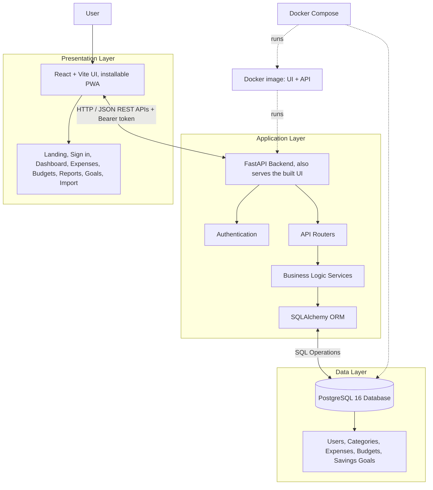
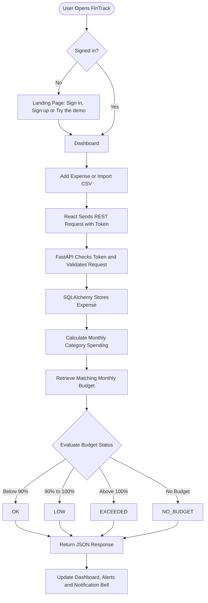
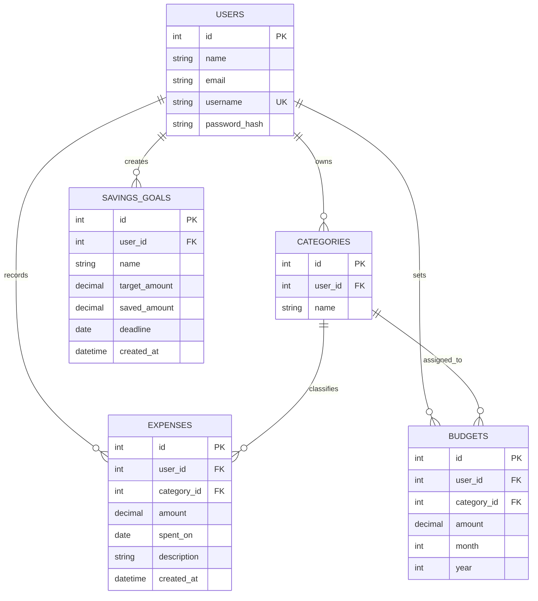

# FinTrack – Smart Expense & Savings Management System

<p align="center">
  
</p>

<p align="center">
  <strong>A smarter way to track expenses, manage budgets, and achieve financial goals.</strong>
</p>

<p align="center">
  
  
  
  
  
  
</p>

---

## Overview

**FinTrack** is a full-stack personal finance management application that helps users understand where their money goes, control monthly spending, and track their savings goals.

Instead of manually maintaining expense records and calculating budgets, FinTrack provides a centralized dashboard that organizes financial transactions, monitors category-wise spending, and automatically identifies budget limits. Expenses can be typed in one by one or imported in bulk from a bank statement (CSV).

The application follows a three-tier architecture with a React frontend, a Python FastAPI backend, and a PostgreSQL relational database. The built React UI is served by the backend, so the whole application runs as **one web service** with one URL.

Its key design principle is to keep financial calculations and budget-monitoring logic in the backend while providing a simple and interactive experience through the frontend.

## The Problem

Managing personal finances becomes difficult when expenses are recorded in different places and monthly budgets are tracked manually.

Common challenges include:

- Losing track of daily spending.
- Difficulty identifying high-spending categories.
- Exceeding monthly budgets without noticing.
- Comparing actual expenses against planned budgets.
- Re-typing transactions that already exist in a bank statement.
- Maintaining consistent savings goals.

## The Solution

FinTrack addresses these challenges through an integrated expense and budget management system.

It records daily transactions, organizes them into categories, calculates monthly spending, compares expenses against allocated budgets, and displays alerts when spending approaches or exceeds a budget. Bank statements can be imported as CSV files, and every user has a private account.

Users can also create savings goals, monitor their progress, and install FinTrack on a phone or computer like a native app.

---

## Key Features

### 1. Accounts and Demo Mode

- Landing page that explains the application.
- Sign up and sign in with a username and password.
- Every user sees only their own data. New accounts start empty with default categories.
- **Try the demo** button opens a shared demo account with **12 months** of realistic data.
- Passwords are stored as salted PBKDF2 hashes. The API uses signed bearer tokens.

### 2. Expense Management

- Record daily expenses with amount, category, date, and description.
- Create, view, update, and delete transactions.
- Filter expenses by month. Long lists are paged (10 per page).
- Quick **Add expense** button on every page (a round **+** button on phones).

### 3. Category-Based Budget Management

- Set individual monthly budgets for expense categories.
- Maintain separate budgets for different months and years.
- Update existing category budgets and add custom categories.
- View allocated, spent, and remaining amounts.

### 4. Intelligent Budget Monitoring and Notifications

FinTrack evaluates budget utilization in the backend whenever relevant expense information changes.

| Budget condition | Status | UI indication |
|---|---|---|
| More than 10% of the budget left | OK | Green |
| 10% or less left (90% to 100% used) | LOW | Amber |
| More than 100% used | EXCEEDED | Red |
| No budget configured | NO_BUDGET | Informational |

**Calculation logic:**

Remaining Amount = Allocated Budget − Total Spending

Budget Utilization (%) = (Total Spending / Allocated Budget) × 100

The backend determines the alert status and returns it as part of the API response. The frontend is responsible only for displaying the result:

- Dismissible alert banners on the dashboard and the Expenses page.
- A **notification bell** with an unread count and a list of LOW and EXCEEDED budgets.
- A short message right after saving an expense that pushes a budget over a limit.

Budget calculations are protected against division by zero, and amounts of zero or less are rejected.

### 5. CSV Import (Bank Statements)

- Download a ready-made CSV template.
- Upload the template or a bank statement export as it is.
- Review the rows before anything is saved (a dry run).
- Categories are guessed from the description (for example *Swiggy* becomes *Food*), and unknown categories are created.
- Duplicate rows are skipped, so importing the same file twice is safe.

### 6. Financial Reports and Analytics

- **Monthly budget utilization:** a progress ring with total budget, spent, and remaining amounts, plus a usage bar and percentage for every category.
- **Spending vs budget:** a donut chart and grouped horizontal bars per category.
- **Total spending per month:** a 12-month trend chart.
- A details table with budget, spent, remaining, and status for each category.
- Built with Recharts. Categories with no spending show as zero.

### 7. Savings Goal Tracking

- Create savings goals with target amounts and optional target dates.
- Record contributions towards goals.
- Track current savings and progress (capped at 100%).

### 8. Centralized Dashboard

- Monthly spending total, budget ring, and a spending split by category.
- Month-end projection based on the current spending pace.
- Day-by-day spending chart.
- Recent activity grouped by day, 5 items per page.
- Category budgets and savings goal progress.

### 9. Installable App Experience

- Progressive Web App: manifest, icons, and a service worker.
- **Install app** button in Chrome and Edge. On iPhone: Share, then *Add to Home Screen*.
- Phone layout with a top app bar, bottom tab bar, and slide-up sheets.
- All amounts are shown in Indian Rupees (₹).

---

## System Architecture

FinTrack follows a **three-tier architecture** to maintain separation of responsibilities, modularity, and maintainability.



### Architecture Responsibilities

| Layer | Technology | Responsibility |
|---|---|---|
| Presentation | React + Vite | User interaction and data visualization |
| Application | FastAPI | REST APIs, validation, authentication, and serving the UI |
| Service | Python | Expense calculations, budget evaluation, imports, and reports |
| Persistence | SQLAlchemy ORM | Database queries and object-relational mapping |
| Data | PostgreSQL 16 | Persistent relational data storage |
| Deployment | Docker, Docker Compose, Render | Containerized build and execution |

### Why This Architecture?

- **Separation of concerns:** Each layer has a clearly defined responsibility.
- **Maintainability:** Backend business logic is separated from HTTP routes.
- **Data consistency:** Financial calculations are handled centrally in the backend.
- **Modularity:** New features can be added without restructuring the entire application.
- **Portability:** One Docker image contains both the UI and the API, so it runs the same locally and in the cloud.

---

## Application Workflow

The following workflow explains how an expense moves through the application.



### Example Budget Evaluation

Consider a monthly Food budget of ₹5,000.

| Total spending | Remaining | Result |
|---:|---:|---|
| ₹2,000 | ₹3,000 | OK |
| ₹4,000 | ₹1,000 | OK |
| ₹4,500 | ₹500 | LOW |
| ₹5,000 | ₹0 | LOW |
| ₹5,500 | -₹500 | EXCEEDED |

This evaluation is performed by the backend using monthly category-wise expense aggregation.

---

## Database Design

FinTrack uses PostgreSQL 16 with the SQLAlchemy 2.x ORM.

The relational database contains the following entities:

| Table | Description |
|---|---|
| users | Stores accounts (name, username, password hash) |
| categories | Stores expense categories of each user |
| expenses | Stores individual expense transactions |
| budgets | Stores category-wise monthly budgets |
| savings_goals | Stores savings targets and current progress |

### Entity Relationships



### Database Design Considerations

- Primary and foreign keys maintain relational integrity.
- Every record belongs to one user, and every query is filtered by the signed-in user.
- Financial values use `Numeric(10, 2)` (Python `Decimal`), never floating point.
- Monthly budgets are identified using category, month, and year.
- A uniqueness constraint prevents duplicate budgets for the same category and month.
- A check constraint keeps expense amounts greater than zero.
- Category names are unique per user, and usernames are unique.
- Older databases created before login existed are upgraded automatically on startup (`app/migrations.py`).

---

## REST API Documentation

The frontend communicates with FastAPI through JSON-based REST endpoints.

Interactive API documentation is available through Swagger UI.

**Swagger URL:** `http://localhost:8000/docs`

All endpoints except `/health`, `/auth/register`, `/auth/login`, `/auth/demo` and `/import/template` require the header `Authorization: Bearer <token>`. Requests without a valid token receive HTTP 401.

### API Endpoint Reference

| Module | Method | Endpoint | Purpose |
|---|---|---|---|
| Health | GET | `/health` | Check backend availability |
| Auth | POST | `/auth/register` | Create an account and receive a token |
| Auth | POST | `/auth/login` | Sign in and receive a token |
| Auth | POST | `/auth/demo` | Sign in as the demo user |
| Auth | GET | `/auth/me` | Retrieve the signed-in user |
| Categories | GET | `/categories` | Retrieve categories |
| Categories | POST | `/categories` | Create a category |
| Expenses | GET | `/expenses?month=YYYY-MM` | Retrieve expenses |
| Expenses | POST | `/expenses` | Add an expense (response includes the alert) |
| Expenses | PUT | `/expenses/{id}` | Update an expense (response includes the alert) |
| Expenses | DELETE | `/expenses/{id}` | Delete an expense |
| Budgets | GET | `/budgets?month=YYYY-MM` | Retrieve monthly budgets |
| Budgets | PUT | `/budgets` | Create or update a budget |
| Alerts | GET | `/alerts?month=YYYY-MM` | Retrieve budget statuses |
| Reports | GET | `/reports/monthly-total?month=YYYY-MM` | Retrieve monthly spending |
| Reports | GET | `/reports/budget-vs-spend?month=YYYY-MM` | Compare budget and spending |
| Reports | GET | `/reports/monthly-trend?month=YYYY-MM&months=12` | Total spending of each of the last N months |
| Goals | GET | `/goals` | Retrieve savings goals |
| Goals | POST | `/goals` | Create a savings goal |
| Goals | PATCH | `/goals/{id}/contribute` | Add a savings contribution |
| Import | GET | `/import/template` | Download the CSV template |
| Import | POST | `/import/expenses?dry_run=true` | Preview a CSV import (`dry_run=false` saves it) |

### Example API Request

Sign in as the demo user:

```http
POST /auth/demo
```

```json
{
  "token": "eyJ1aWQiOjEsImV4cCI6...",
  "user": { "id": 1, "name": "Demo User", "username": "demo", "is_demo": true }
}
```

Create an expense:

```http
POST /expenses
Content-Type: application/json
Authorization: Bearer <token>
```

```json
{
  "category_id": 1,
  "amount": "250.00",
  "spent_on": "2026-11-27",
  "description": "Lunch"
}
```

Create or update a monthly budget:

```http
PUT /budgets
Content-Type: application/json
Authorization: Bearer <token>
```

```json
{
  "category_id": 1,
  "month": 11,
  "year": 2026,
  "amount": "5000.00"
}
```

Retrieve budget alerts:

```http
GET /alerts?month=2026-11
Authorization: Bearer <token>
```

The same calls with `curl`:

```bash
TOKEN=$(curl -s -X POST http://localhost:8000/auth/demo | python -c "import sys,json;print(json.load(sys.stdin)['token'])")
curl -H "Authorization: Bearer $TOKEN" "http://localhost:8000/alerts?month=2026-11"
```

All API requests are validated by the backend before database operations are performed.

---

## CSV Import Format

| Column | Required | Notes |
|---|---|---|
| `date` | Yes | `2026-11-05`, `05/11/2026` or `05-11-2026`. Bank names such as `Txn Date` also work. |
| `amount` | Yes | `1250.50`, `1,250.50` or `₹ 1250`. Bank names such as `Debit` or `Withdrawal Amt` also work. Empty or zero rows (credits) are skipped. |
| `category` | No | Matched ignoring case. A new name creates a new category. If empty, it is guessed from the description or set to *Other*. |
| `description` | No | Also read from `Narration`, `Particulars` or `Remarks`. |

Up to 2000 rows per file. A row with the same date, amount, and description as an existing expense is skipped as a duplicate.

---

## Project Structure

```text
FinTrack/
│
├── backend/
│   ├── app/
│   │   ├── main.py            (app setup, error handlers, serves the UI)
│   │   ├── database.py
│   │   ├── config.py
│   │   ├── auth.py            (current-user dependency)
│   │   ├── security.py        (password hashing and tokens)
│   │   ├── migrations.py      (automatic schema upgrade)
│   │   ├── keep_alive.py      (pings /health every 14.5 minutes on Render)
│   │   │
│   │   ├── models/            (user, category, expense, budget, savings_goal)
│   │   ├── schemas/           (auth, expense, category, budget, report, savings_goal, importer)
│   │   ├── routers/           (auth, categories, expenses, budgets, alerts, reports, goals, importer)
│   │   └── services/          (auth, demo, expense, budget, alert, report, goal, import)
│   │
│   ├── tests/                 (alerts, auth, import, validation and reports)
│   ├── seed.py
│   └── requirements.txt
│
├── frontend/
│   ├── public/                (logo, icons, manifest.json, sw.js)
│   ├── src/
│   │   ├── components/        (AlertBanner, Notifications, Pager, Sheet, charts, forms)
│   │   ├── pages/             (Landing, AuthPage, Dashboard, Expenses, Budgets, Reports, Goals, Import)
│   │   ├── api.js
│   │   ├── App.jsx
│   │   ├── icons.jsx
│   │   └── styles.css
│   │
│   └── package.json
│
├── Dockerfile                 (builds the UI, then the backend that serves it)
├── docker-compose.yml         (app + PostgreSQL)
├── render.yaml                (Render Blueprint: web service + database)
├── .env.example
├── .gitignore
└── README.md
```

---

## Technology Stack

| Technology | Usage |
|---|---|
| React.js | Component-based frontend |
| Vite | Frontend development and build tooling |
| JavaScript | Frontend application logic |
| CSS3 | Interface styling and responsive layout |
| Recharts | Financial charts and visualization |
| PWA (manifest + service worker) | Installable app experience |
| Python | Backend programming |
| FastAPI | REST API framework |
| Pydantic | Input and output validation |
| SQLAlchemy 2.x | ORM and database operations |
| PostgreSQL 16 | Relational database |
| psycopg2 | PostgreSQL driver |
| Uvicorn | ASGI application server |
| Docker | Application containerization |
| Docker Compose | Multi-container orchestration |
| Render | Cloud hosting |
| Pytest | Backend testing |

---

## Installation and Execution

### Prerequisites

- Docker
- Docker Compose

### Step 1: Clone the Repository

```bash
git clone https://github.com/Shubhashree-Badiger/FinTrack.git
cd FinTrack
```

### Step 2: Configure Environment Variables

Copy the example configuration:

```bash
cp .env.example .env
```

For Windows PowerShell:

```powershell
Copy-Item .env.example .env
```

The default values work for local use. `.env` is git-ignored and must never be committed.

| Variable | Used by | Purpose |
|---|---|---|
| `POSTGRES_DB`, `POSTGRES_USER`, `POSTGRES_PASSWORD` | Docker Compose | Database container settings |
| `DATABASE_URL` | app | PostgreSQL URL. `postgres://` and `postgresql://` are converted to the psycopg2 driver automatically |
| `SECRET_KEY` | app | Signs login tokens. Use a long random value when deploying |
| `DB_SSL` | app | `true` when connecting over the public internet (for example Render's External URL) |
| `STATIC_DIR` | app | Folder with the built UI (`static` inside the Docker image) |
| `FRONTEND_ORIGIN` | app | Extra CORS origin, only needed when the UI runs separately with `npm run dev` |
| `KEEP_ALIVE`, `KEEP_ALIVE_URL`, `KEEP_ALIVE_SECONDS` | app | Render keep-alive ping (see *Deploying on Render*). On by default when a public URL is known; `KEEP_ALIVE=false` turns it off |

### Step 3: Build and Run

```bash
docker compose up --build
```

Docker Compose builds one image with the UI and the API, and starts it together with PostgreSQL. The app waits for the database healthcheck, creates or upgrades the tables, and refreshes the demo data.

### Step 4: Access the Application

| Service | URL |
|---|---|
| Application (UI) | http://localhost:8000 |
| API (same address) | http://localhost:8000 |
| API Documentation | http://localhost:8000/docs |
| Health Check | http://localhost:8000/health |

### Step 5: Stop the Application

```bash
docker compose down
```

To remove containers and the database volume:

```bash
docker compose down -v
```

**Note:** Removing the volume deletes persisted database data.

### Running Without Docker (optional)

Requires Python 3.11+, Node 20+, and a running PostgreSQL. Set `DATABASE_URL` (see `.env.example`).

```bash
cd backend && pip install -r requirements.txt && python seed.py && uvicorn app.main:app --port 8000
cd frontend && npm install && npm run dev      # UI on http://localhost:5173, calls the API on :8000
```

To serve the built UI from the backend instead, run `npm run build` and start uvicorn with `STATIC_DIR=../frontend/dist`.

### Deploying on Render

The UI and API run as one web service, so there is a single URL.

**Option A: Blueprint (fastest).** In Render choose *New*, then *Blueprint*, and select this repository. `render.yaml` creates the `fintrack-db` PostgreSQL database and the `fintrack` web service, connects `DATABASE_URL`, and generates `SECRET_KEY`.

**Option B: manually.**

1. Create a PostgreSQL database and copy its **Internal Database URL**.
2. Create a Web Service from this repository: runtime Docker, **Root Directory empty**, Dockerfile Path `./Dockerfile`, Health Check Path `/health`, same region as the database.
3. Set the environment variables `DATABASE_URL` (the Internal Database URL) and `SECRET_KEY` (a long random string).

**Keep-alive:** free web services sleep after 15 minutes without traffic. While the app is running, it calls its own `/health` URL every 14.5 minutes (870 seconds) so it stays awake (`app/keep_alive.py`). Render sets `RENDER_EXTERNAL_URL` automatically, so no setup is needed. The ping cannot wake a service that is already asleep (for example after a restart with no visitors); the first visit wakes it, and from then on it stays awake. One always-on free service uses about 744 of the 750 free instance hours per month.

Render's free PostgreSQL instances expire after about 30 days.

---

## Demo Data

The backend includes a seed script (`seed.py`) that runs on every start and is safe to repeat.

It creates or refreshes the **demo account** (username `demo`, password `demo1234`), which the **Try the demo** button signs in to. The demo account contains:

- Seven categories with monthly budgets.
- Expenses for the current month, set up so that one budget is LOW and one is EXCEEDED.
- Realistic expenses for each of the **previous 11 months**, so the reports show a full year (more shopping around the festive months).
- Three savings goals with progress.

To run the seed script manually:

```bash
docker compose exec app python seed.py
```

Months that already have demo expenses are not touched, so no duplicates are created. The demo account is shared, so changes made in it are visible to other demo visitors.

---

## Testing and Validation

The application can be validated through backend tests, Swagger UI, and the frontend.

### Backend Test Execution

```bash
docker compose exec app pytest -q
```

The tests use an in-memory SQLite database and cover alert rules, authentication, data isolation between users, validation, reports, the 12-month trend, the demo account, and CSV import.

### Manual Validation Checklist

1. Start the application using Docker Compose and open http://localhost:8000. The landing page appears.
2. Click **Try the demo**. The dashboard shows ₹ amounts, a red *Entertainment* alert, and an amber *Food* alert.
3. Click the **bell** icon and verify that both alerts are listed. Click *Mark all read* and verify that the badge disappears.
4. Dismiss an alert banner with its **×** button.
5. In *Recent activity*, use the arrows to move between pages of 5 items.
6. Click **Add expense**, save an expense, and verify that a message appears and the totals update.
7. Open Expenses, edit and delete an expense, and verify that the alerts refresh.
8. Open Budgets, change a budget, then switch the month and verify independent budget records.
9. Open Reports and verify the utilization ring, the category usage bars, the donut and bar comparison, and the 12-month trend.
10. Open Goals, create a savings goal, add a contribution, and verify the progress.
11. Open Import, download the template, upload it back, review the preview, and import it. Upload it again and verify that the rows are reported as duplicates.
12. Sign out, click **Get started**, and create an account. Verify that it has no demo data.
13. In the new account, set a Food budget of ₹1,000 and add expenses of ₹500 (OK), ₹410 (LOW), and ₹100 (EXCEEDED).
14. Sign out and sign in again. Try a wrong password and verify the error message.
15. In Chrome or Edge, click **Install app** and verify that FinTrack opens in its own window. Narrow the window (or use a phone) and verify the bottom tab bar.
16. In Swagger UI, call `GET /expenses` without a token and verify HTTP 401.

### Important Validation Areas

- Input validation and error handling.
- Authentication and per-user data isolation.
- Monthly budget separation.
- Accurate financial calculations.
- Backend-generated alert statuses.
- CSV import validation and duplicate detection.
- Database persistence.
- Frontend-backend API communication.
- Docker service connectivity.

---

## Design and Engineering Decisions

### Why FastAPI?

FastAPI provides a structured approach to developing Python REST APIs, request validation, and interactive API documentation.

### Why SQLAlchemy?

SQLAlchemy provides an ORM abstraction that makes relational database operations easier to organize and maintain, and lets the tests run on SQLite while production uses PostgreSQL.

### Why PostgreSQL?

PostgreSQL provides relational data storage, constraints, and exact decimal types suitable for financial records, and it is available as a managed database on Render.

### Why React?

React allows the interface to be divided into reusable components and supports dynamic dashboard updates.

### Why One Docker Image?

Serving the built UI from FastAPI gives a single URL, removes CORS setup, and makes deployment one service instead of two.

### Why Backend-Based Budget Evaluation?

Budget calculations are business rules. Keeping them in the backend ensures that the same evaluation logic is used across API consumers and frontend components.

### Why CSV Import Instead of Bank Linking?

Direct bank access in India goes through the regulated Account Aggregator framework, which requires a licensed entity. CSV statements work with any bank, keep the user in control of their data, and need no third-party access.

---

## Current Scope and Future Enhancements

The current version covers accounts, expense tracking, monthly budgeting, automated alerts and notifications, reports with a yearly trend, CSV import, savings goals, and an installable app.

Potential future enhancements include:

- Email notifications for budget alerts.
- Custom alert thresholds per category.
- Group expense sharing.
- Expense export functionality.
- Account Aggregator (sandbox) integration for automatic bank sync.

These are possible extensions and are not claimed as implemented features.

---

## Author

**Shubhashree B Badiger**

B.E. – Computer Science and Engineering (Artificial Intelligence and Machine Learning)

Vidyavardhaka College of Engineering, Mysuru

GitHub: [Shubhashree-Badiger](https://github.com/Shubhashree-Badiger)

---

<p align="center">
  <strong>FinTrack – Track Better. Spend Smarter. Save More.</strong>
</p>
